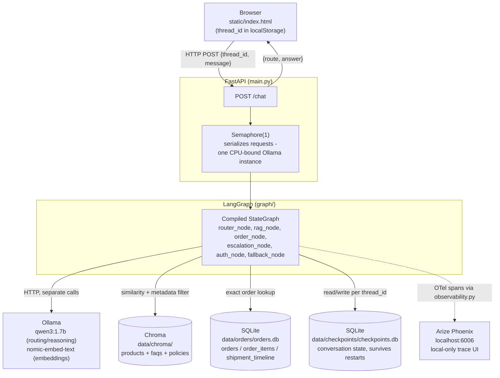
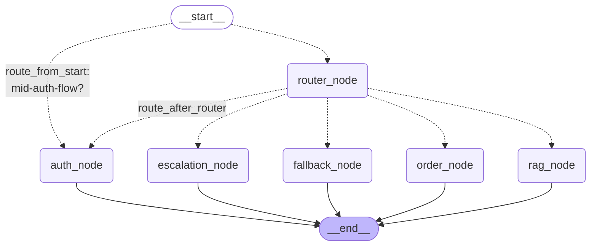

# Architecture

Two diagrams: the full system (everything the agent depends on), and the graph's internal
routing logic (regenerated directly from the live compiled graph via `scripts/visualize_graph.py`
— not hand-drawn, so it can't silently drift from the real code).

## System overview



**Why each arrow is the shape it is, not just that it exists:**
- Browser → FastAPI is the only network hop a user ever makes; everything else is server-side.
- The graph talks to Ollama over its *own* separate HTTP calls — FastAPI never touches Ollama directly, it only ever calls `graph.invoke()`.
- Chroma is reached via *similarity search filtered by metadata* (never a raw unfiltered scan, after the Weekend 2 fix) — two different query mechanisms depending on whether it's a RAG answer (similarity) or a comparison (exact metadata `$in` filter).
- Orders and checkpoints are two **separate** SQLite databases, not one — orders is business data seeded from JSON, checkpoints is live conversation state that grows from real usage. Conflating them would mix a regeneratable artifact with real runtime state.
- The Phoenix arrow is dashed because it's *fire-and-forget telemetry* — if Phoenix is down, tracing silently drops (confirmed empirically — a connection-refused error during testing didn't crash the actual request).

## Graph-internal routing (regenerated from the live graph, `docs/graph/router_graph.mmd`)



**The two conditional edges aren't redundant** (a common point of confusion worth being able to explain cold): `route_from_start` only checks "are we mid-OTP-exchange right now" — it bypasses the router entirely during an in-progress auth flow, since the router has no concept of conversation stage. `route_after_router` handles everything else, including the *separate* case of an unauthenticated user hitting `ORDER` for the first time, which it redirects to `auth_node` as a fresh entry, not a resumption.

### Inside `rag_node` — not visible in the graph diagram above, since it's one node's internal logic, not graph structure

```
rag_node
  └─ classify_query() → one of: comparison | policy | unsure | product | faq
       ├─ "comparison" → compare_products()       (exact metadata fetch, no similarity search)
       ├─ "unsure"     → decline early             (skips retrieval entirely - cost/confidence fix)
       ├─ "policy"     → retrieve → rerank → generate_policy_answer()  (quote-verified + cited)
       └─ "product"/"faq" → retrieve → rerank → generate_answer()     (numeric-fact-checked)
```
